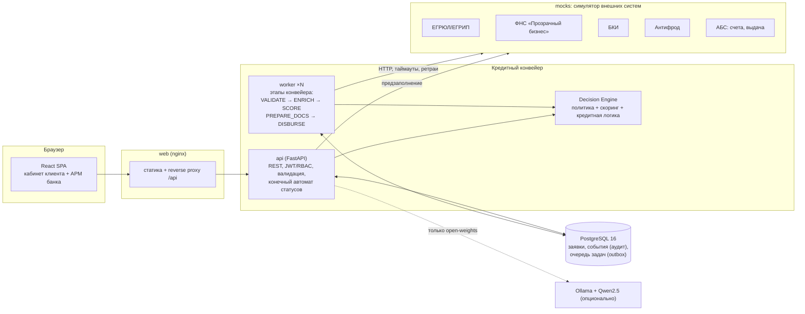

# CreditFlow — умный кредитный кабинет предпринимателя

**Команда «Нейрослопики»** · Альфа-Хак 2026 · кейс «Умный кредитный кабинет предпринимателя»

[](https://github.com/VV00nder/Alfa-hack-2026/actions/workflows/ci.yml)
[](https://vv00nder.github.io/Alfa-hack-2026/)

> **Живое демо без установки: https://vv00nder.github.io/Alfa-hack-2026/** — работает прямо в браузере (см. [режимы запуска](#режимы-запуска)).
> **Полная версия** — `docker compose up --build` на любом ПК или сервере.

Прототип **цифрового кредитного конвейера для малого и микробизнеса** (кейс Альфа-Хак 2026). В одном продукте объединены:

* **клиентский путь** — подбор продукта под задачу бизнеса (анкета или свободный текст), заявка с предзаполнением из ЕГРЮЛ и ФНС, живой статус, понятные причины решения, встречные предложения, подписание и выдача;
* **внутренняя обработка в банке** — проверка полноты, обогащение данными (ЕГРЮЛ, ФНС «Прозрачный бизнес», БКИ, антифрод, АБС), скоринг, кредитная логика, ручное рассмотрение, согласование по принципу «четырёх глаз», аудит и метрики.

> Все данные синтетические. Внешние системы воспроизводятся сервисом-симулятором `mocks`. Платные сервисы и закрытые API не используются.

---

## Содержание

1. [Что умеет прототип](#1-что-умеет-прототип)
2. [Быстрый старт](#2-быстрый-старт)
3. [Тестовые учётные записи и данные](#3-тестовые-учётные-записи-и-данные)
4. [Пошаговый сценарий проверки](#4-пошаговый-сценарий-проверки-1015-минут)
5. [Архитектура](#5-архитектура)
6. [Компоненты и технологии](#6-компоненты-и-технологии)
7. [Конфигурация и переменные окружения](#7-конфигурация-и-переменные-окружения)
8. [Тесты](#8-тесты)
9. [Документация](#9-документация)
10. [Границы MVP и допущения](#10-границы-mvp-и-допущения)

---

## 1. Что умеет прототип

| Для предпринимателя | Для банка |
|---|---|
| Подбор продукта: 3 вопроса **или** текст «нужно 3 млн на печь на 2 года» → ранжированные продукты с объяснением | Очередь заявок с фильтрами, SLA, рейтингом; метрики: доля автоматических решений, время до решения, воронка |
| Регистрация по ИНН: данные компании подтягиваются из ЕГРЮЛ | Карточка заявки: данные всех источников, балльная карта, DSCR, стоп-факторы, триггеры ручного рассмотрения |
| Мастер заявки с **автосохранением** черновика и предзаполнением финансов из ФНС | ИИ-резюме заявки для андеррайтера |
| Живой статус: этапы конвейера в реальном времени, таймлайн, уведомления в кабинете | What-if: пересчёт модели при другой сумме, сроке или продукте до принятия решения |
| Решение не бинарное: одобрение, **встречное предложение** (меньше сумма / дольше срок / льготный продукт), запрос информации, отказ с объяснением и советами | Решения: одобрить, встречное предложение, запросить информацию, отказать, передать на комитет |
| Распознавание выписки по счёту (CSV) → подтверждённая выручка | Принцип «четырёх глаз»: суммы > 15 млн ₽ согласует риск-менеджер |
| Подписание договора кодом ПЭП из уведомлений, выдача, график платежей | Журнал аудита, структурированные логи, Prometheus-метрики |
| **Персональная лента новостей**: отрасль, регион, сегмент, этап заявки, реакции; блок «почему вы это видите» | Публикация материалов с таргетингом и **предпросмотр ленты двух клиентов рядом** |
| ИИ-ассистент: подбор продукта, объяснение статуса и условий | Имитация сбоев внешних систем: конвейер переходит на ручное рассмотрение, а не падает |

## Режимы запуска

| | Демо на GitHub Pages | Полная версия (Docker) |
|---|---|---|
| Как открыть | https://vv00nder.github.io/Alfa-hack-2026/ | `docker compose up --build` → http://localhost:8080 |
| Бэкенд | Тот же API, выполняется в браузере ([`frontend/src/demo`](frontend/src/demo)): автомат статусов, этапы конвейера, модель решения, лента, ассистент | FastAPI + PostgreSQL + воркеры + симулятор внешних систем |
| Данные | `localStorage` вашего браузера; кнопка «Сбросить данные» в верхней плашке | PostgreSQL, миграции Alembic |
| Нет в демо | Swagger, аудит в БД, Prometheus, имитация сбоев, LLM, многопользовательская работа | Всё есть |
| Для чего | Быстро пройти сценарии клиента и банка | Проверка жюри, нагрузка, enterprise-аспекты |

Демо-режим включается при сборке фронтенда переменной `VITE_DEMO_MODE=true` (см. [`.github/workflows/pages.yml`](.github/workflows/pages.yml)). Логика решения в демо — порт [`backend/app/scoring/engine.py`](backend/app/scoring/engine.py) и даёт те же результаты на тех же данных.

## 2. Быстрый старт

**Требования:** Docker Desktop 4.x / Docker Engine 24+ с Compose v2, 4 ГБ свободной RAM, свободные порты 8080, 8000, 8090. Интернет нужен только для скачивания образов при первой сборке.

```bash
git clone <repo-url> creditflow && cd creditflow
docker compose up --build
```

Через 1–3 минуты (первая сборка) откройте:

| Адрес | Что это |
|---|---|
| **http://localhost:8080** | Веб-интерфейс (клиент и банк) |
| http://localhost:8000/api/docs | Swagger UI (OpenAPI 3.1) |
| http://localhost:8000/api/redoc | ReDoc |
| http://localhost:8090/docs | Swagger симулятора внешних систем |
| http://localhost:8000/metrics | Метрики Prometheus |

Остановить: `docker compose down`. Сбросить данные: `docker compose down -v`.

**Публичный сервер с HTTPS** (наружу только 80/443, Caddy + Let's Encrypt):

```bash
cp .env.example .env   # задайте DOMAIN, JWT_SECRET, POSTGRES_PASSWORD
docker compose -f docker-compose.yml -f deploy/docker-compose.prod.yml up -d --build
```

Подробно — [docs/deployment.md](docs/deployment.md).

**Опционально — open-weights LLM** (Qwen2.5-1.5B-Instruct через Ollama, ~1 ГБ):

```bash
LLM_ENABLED=true docker compose --profile ai up --build
```

Без LLM всё работает: ассистент переключается на правила и базу знаний. Режим виден в ответе (`engine`).

**Проверка одной командой** после запуска стенда:

```bash
python scripts/e2e_smoke.py
```

Нужен только Python 3.9+, сторонние пакеты не требуются.

## 3. Тестовые учётные записи и данные

На странице входа есть кнопки входа в один клик. Пароль клиентов — `Demo123!`.

| Логин | Пароль | Роль | Сценарий |
|---|---|---|---|
| `bakery@demo.ru` | `Demo123!` | Клиент, ООО «Хлебный Дом» (10.71, Москва) | Сильный профиль → **автоодобрение** → подписание → выдача |
| `smirnov@demo.ru` | `Demo123!` | Клиент, ИП Смирнов (49.41, Татарстан) | Не хватает денежного потока → **встречное предложение** (меньшая сумма / льготный продукт) |
| `stroy@demo.ru` | `Demo123!` | Клиент, ООО «СтройМонтаж Плюс» (41.20) | 15 млн → **запрос отчётности** → **ручное рассмотрение** (просрочки, отметки ФНС) |
| `romashka@demo.ru` | `Demo123!` | Клиент, ООО «Ромашка Трейд» (47.19) | Стоп-факторы → **отказ с объяснением** и советами |
| `analyst@bank.ru` | `Analyst123!` | Кредитный аналитик | Очередь ручного рассмотрения, решения |
| `risk@bank.ru` | `Risk123!` | Риск-менеджер | Согласование сумм > 15 млн ₽ |
| `admin@bank.ru` | `Admin123!` | Администратор | Публикация материалов ленты, аудит |

* **Регистрация по любому корректному ИНН**: симулятор ЕГРЮЛ детерминированно сгенерирует профиль компании (пример: `7720123457`).
* При запуске создаётся **история из 6 заявок** других компаний (прогоном через настоящий конвейер): есть заявки в ручном рассмотрении (в т.ч. 25 млн под залог — сценарий комитета), подписание, выдача.
* Профили внешних источников: [`mocks/fixtures.json`](mocks/fixtures.json). Пример выписки: [`testdata/bank_statement_sample.csv`](testdata/bank_statement_sample.csv).

## 4. Пошаговый сценарий проверки (10–15 минут)

Подробно с ожидаемыми результатами: [docs/test-scenarios.md](docs/test-scenarios.md).

1. **Клиент «Хлебный Дом»** (`bakery@demo.ru`). На главной — персональная лента: льготы для производителей и материал для пекарен, у каждой карточки есть «почему вы это видите».
2. «💬 Помощник» → «Нужно 3 млн на новое оборудование на 2 года» → ассистент распознал цель, сумму и срок и предложил продукты → «Оформить».
3. Мастер: компания из ЕГРЮЛ (поставить «Данные верны»), финансы из ФНС уже подставлены → согласия → «Отправить».
4. На странице заявки этапы идут в реальном времени: проверка → ЕГРЮЛ/ФНС/БКИ → оценка → **Одобрена**. Ниже блок «Что повлияло на решение».
5. «Принять» → договор сформирован → код подписи в 🔔 → «Подписать» → **Деньги выданы**, график платежей. Лента изменилась: появились материалы для этапа «выдан».
6. **Клиент «ИП Смирнов»** → экспресс-кредит 5 млн на 24 мес. → **встречное предложение**: меньшая сумма или льготный кредит МСП (выберите любой).
7. **Клиент «СтройМонтаж»** → «Оборотный кредит» 15 млн → банк **запрашивает отчётность** → загрузите любой PDF → «Отправить» → **у специалиста**.
8. **Аналитик** (`analyst@bank.ru`) → очередь → заявка «СтройМонтаж»: источники, балльная карта, DSCR, триггеры, ИИ-резюме → измените сумму (what-if пересчитывается) → «Встречное предложение» с комментарием. Клиент видит новое предложение.
9. Аналитик → заявка «МФ Кедр» на 25 млн → «Одобрить» → уходит **на согласование** → вход `risk@bank.ru` → «Согласовать».
10. **Администратор** (`admin@bank.ru`) → «Лента новостей»: две ленты рядом (пекарня и перевозчик) → опубликуйте материал с ОКВЭД `10.7` → он появляется только у пекарни.
11. **Отказоустойчивость**: `curl -X POST localhost:8090/admin/chaos -H "Content-Type: application/json" -d '{"source":"bki","failure_rate":1}'` → новая заявка уходит **на ручное рассмотрение** с пометкой «Источник недоступен» и не теряется. Вернуть: `failure_rate: 0`.

## 5. Архитектура



Ключевые решения (подробно — [docs/architecture.md](docs/architecture.md)):

* **Конечный автомат** — единственное место, где меняется статус заявки. Каждый переход проверяется, пишется в журнал событий (это и аудит, и таймлайн клиента) и порождает уведомление и задачу конвейера в **одной транзакции** (transactional outbox).
* **Асинхронный конвейер**: `worker` забирает задачи через `SELECT … FOR UPDATE SKIP LOCKED` и масштабируется горизонтально (`--scale worker=3`). Ретраи с экспоненциальной паузой, этапы идемпотентны.
* **Мягкая деградация**: если источник недоступен, заявка уходит на ручное рассмотрение с пометкой, а не падает.
* **Скоринг ≠ решение**: балльная карта оценивает риск заёмщика, а кредитная логика по продукту и денежному потоку (DSCR) выбирает исход и условия. Версия модели сохраняется в каждой заявке.
* **Оптимистическая блокировка** (`version`) защищает от двойного решения двух аналитиков.

Диаграммы: [архитектура](docs/architecture.md) · [статусы заявки](docs/state-machine.md) · [модель данных](docs/data-model.md) · [модель решения](docs/decision-model.md).

## 6. Компоненты и технологии

| Компонент | Технологии | Назначение |
|---|---|---|
| `frontend/` | React 18.3, TypeScript 5.6, Vite 5.4, React Router 6.28; nginx 1.27 (unprivileged) | SPA клиента и сотрудника банка |
| `backend/` | Python 3.12, FastAPI 0.115, SQLAlchemy 2.0, Alembic 1.14, Pydantic 2.10, PyJWT, bcrypt, httpx, prometheus-client | API, конвейер, модель решения |
| `backend` → `worker` | тот же образ, `python -m app.cli worker` | исполнитель этапов конвейера |
| `backend` → `migrate` | тот же образ, `python -m app.cli init` | миграции и демо-данные (одноразовая задача) |
| `mocks/` | FastAPI | ЕГРЮЛ, ФНС, БКИ, антифрод, АБС; управление сбоями |
| `db` | PostgreSQL 16.6 | основное хранилище |
| `ollama` (профиль `ai`) | Ollama 0.5.4 + Qwen2.5-1.5B-Instruct (Apache-2.0) | опциональная LLM для ассистента |

**Фиксация версий:** `backend/requirements.txt` и `mocks/requirements.txt` — lock-файлы pip-tools с хэшами (`--require-hashes`); `frontend/package-lock.json`; базовые образы Docker закреплены по версиям.

Структура репозитория:

```
backend/          FastAPI: app/api (роутеры), app/services (конвейер, интеграции, лента, ассистент),
                  app/scoring (модель решения), migrations (Alembic), tests (pytest)
frontend/         React SPA: pages/client, pages/bank, components; src/demo — API в браузере для GitHub Pages
mocks/            симулятор внешних систем + fixtures.json (синтетические профили)
deploy/           прод-оверлей docker compose + Caddy (HTTPS)
.github/          CI (тесты, линтер, сборка, e2e на стенде) и публикация демо на Pages
docs/             архитектура, API (OpenAPI, Postman), статусы, данные, модель решения,
                  тест-сценарии, исследование, материалы защиты
scripts/          e2e_smoke.py — сквозная проверка стенда
testdata/         пример выписки по счёту (CSV)
```

## 7. Конфигурация и переменные окружения

Значения по умолчанию подходят для локального запуска. Для переопределения скопируйте `.env.example` в `.env`.

| Переменная | По умолчанию | Описание |
|---|---|---|
| `POSTGRES_USER` / `POSTGRES_PASSWORD` / `POSTGRES_DB` | `creditflow` | Учётные данные БД |
| `DATABASE_URL` | собирается из переменных выше | DSN SQLAlchemy (`postgresql+psycopg://…`) |
| `JWT_SECRET` | dev-значение | Секрет подписи JWT; в проде — из секрет-хранилища |
| `JWT_TTL_MINUTES` | `480` | Время жизни токена |
| `MOCKS_URL` | `http://mocks:8090` | Адрес симулятора внешних систем |
| `INTEGRATION_TIMEOUT_SEC` / `INTEGRATION_RETRIES` | `3.0` / `3` | Таймаут и число попыток вызова источника |
| `KEY_RATE` | `14.0` | Ключевая ставка ЦБ, % (база ценообразования) |
| `AUTO_DECISION_LIMIT` | `10000000` | Выше этой суммы автоматическое одобрение запрещено |
| `COMMITTEE_LIMIT` | `15000000` | Выше — второе подтверждение риск-менеджера |
| `OFFER_TTL_DAYS` | `14` | Срок действия предложения |
| `PIPELINE_STEP_DELAY_SEC` | `1.5` | Пауза между этапами (наглядность демо; `0` — мгновенно) |
| `RUN_PIPELINE_INLINE` | `false` | Выполнять этапы синхронно без воркера (тесты) |
| `SEED_DEMO_DATA` | `true` | Загрузить синтетические демо-данные |
| `MOCK_LATENCY_MS` / `MOCK_FAILURE_RATE` | `150` / `0` | Задержка и доля сбоев симулятора |
| `LLM_ENABLED` / `LLM_MODEL` / `OLLAMA_URL` | `false` / `qwen2.5:1.5b-instruct` / `http://ollama:11434` | Опциональная open-weights LLM |
| `MAX_UPLOAD_MB` | `5` | Ограничение размера документа |

## 8. Тесты

```bash
# юнит- и сквозные API-тесты (SQLite, синхронный конвейер, моки in-process) — 24 теста
docker build --target test --build-context mocks=./mocks -t creditflow-test backend && docker run --rm creditflow-test

# линтер
docker run --rm creditflow-test ruff check .

# сквозная проверка запущенного стенда (PostgreSQL + воркер + nginx)
python scripts/e2e_smoke.py
```

Покрыто: контрольные суммы ИНН, аннуитет и график, достижимость всех статусов, независимость скоринга от суммы, исходы модели, стоп-факторы и триггеры, разбор текста потребности, распознавание выписки, полный путь до выдачи, встречное предложение, запрос информации, решение аналитика, «четыре глаза», деградация при сбое БКИ, разграничение доступа, персонализация ленты, регистрация по ИНН, метрики. Ручные сценарии: [docs/test-scenarios.md](docs/test-scenarios.md). Postman: [docs/api/CreditFlow.postman_collection.json](docs/api/CreditFlow.postman_collection.json).

## 9. Документация

| Документ | Содержание |
|---|---|
| [docs/architecture.md](docs/architecture.md) | Архитектура, потоки, надёжность, безопасность, масштабирование, путь в прод |
| [docs/state-machine.md](docs/state-machine.md) | Диаграмма состояний заявки, переходы, роли |
| [docs/data-model.md](docs/data-model.md) | ER-диаграмма и описание сущностей |
| [docs/decision-model.md](docs/decision-model.md) | Стоп-факторы, балльная карта, DSCR, ценообразование, исходы |
| [docs/api.md](docs/api.md) | Описание API, авторизация, ошибки, примеры |
| [docs/api/openapi.json](docs/api/openapi.json) | OpenAPI 3.1 основного API |
| [docs/api/mocks-openapi.json](docs/api/mocks-openapi.json) | OpenAPI симулятора внешних систем |
| [docs/api/CreditFlow.postman_collection.json](docs/api/CreditFlow.postman_collection.json) | Коллекция Postman со сквозным сценарием |
| [docs/test-scenarios.md](docs/test-scenarios.md) | Тестовые сценарии с ожидаемыми результатами |
| [docs/research.md](docs/research.md) | Исследование: JTBD, CJM, конкуренты, гипотезы, RICE, MoSCoW, границы MVP |
| [docs/deployment.md](docs/deployment.md) | Публикация на бесплатном сервере, чек-лист сдачи |
| [docs/pitch/](docs/pitch/) | Презентация, сценарий демо, ответы на вопросы жюри |
| [THIRD_PARTY_NOTICES.md](THIRD_PARTY_NOTICES.md) | Сторонние компоненты, модели, данные, смоделированные интеграции |

## 10. Границы MVP и допущения

* **Внешние сервисы смоделированы** (ЕГРЮЛ, ФНС, БКИ, антифрод, АБС): контракты упрощены, смысл интеграции сохранён (согласие на запрос в БКИ, идемпотентная выдача по `application_id`).
* **Модель решения упрощена и описана явно**: экспертная балльная карта с синтетической калибровкой PD, а не обученная модель. Параметры — в одном модуле и версионируются.
* **Подписание** — простая электронная подпись кодом из уведомлений в кабинете (без SMS и e-mail по условию кейса). **Выдача** — вызов симулятора АБС.
* **Овердрафт** в прототипе моделируется как краткосрочный аннуитетный кредит.
* **Документы** хранятся в PostgreSQL (до 5 МБ); в проде — S3-совместимое хранилище с антивирусной проверкой.
* Новостная лента содержит **демо-контент**; факты о ключевой ставке соответствуют открытым данным Банка России на октябрь 2026.
