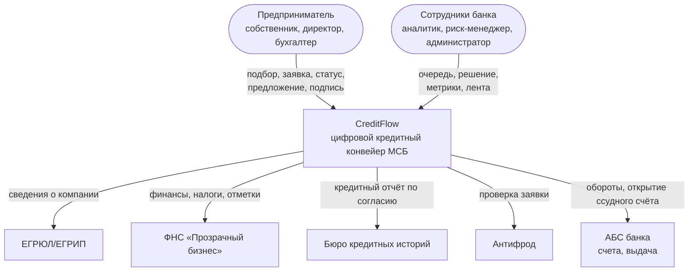
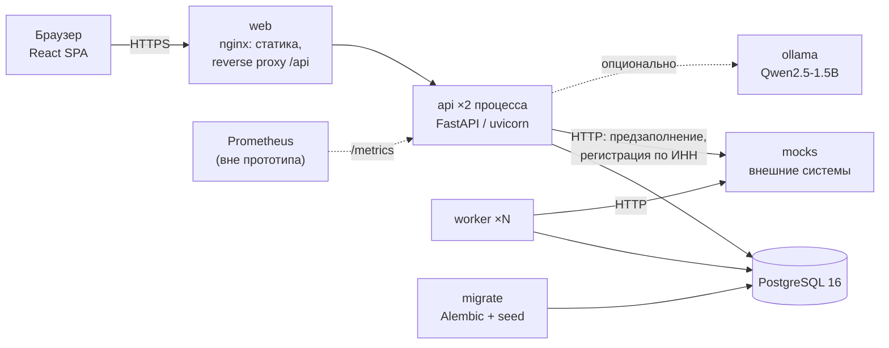
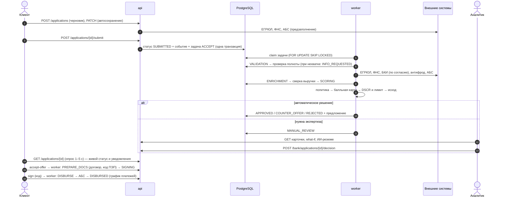

# Архитектура CreditFlow

## 1. Контекст (C4, уровень 1)



В прототипе все внешние системы — сервис `mocks` (контракты упрощены, смысл сохранён).

## 2. Контейнеры (C4, уровень 2)



| Контейнер | Ответственность | Масштабирование |
|---|---|---|
| `web` | Раздача SPA, проксирование `/api`, заголовки безопасности, динамический DNS-резолв `api` | Горизонтально, без состояния |
| `api` | REST API, аутентификация, RBAC, валидация, конечный автомат, синхронные операции клиента и сотрудника | Горизонтально, без состояния (JWT) |
| `worker` | Асинхронные этапы конвейера: `ACCEPT → VALIDATE → ENRICH → SCORE`, `PREPARE_DOCS`, `DISBURSE` | Горизонтально (`--scale worker=N`), конкуренция через `SKIP LOCKED` |
| `migrate` | Миграции Alembic и загрузка демо-данных; одноразовая задача перед стартом `api`/`worker` | — |
| `db` | Заявки, события, документы, очередь задач, справочники, аудит | Вертикально, далее реплики и пулер |
| `mocks` | Симулятор внешних систем с управляемой задержкой и сбоями | — |
| `ollama` | Open-weights LLM (профиль `ai`) | Отдельный GPU-узел в проде |

## 3. Модули backend

```
app/
  main.py            сборка приложения, middleware (request-id, метрики, заголовки), health
  config.py          настройки из переменных окружения (12-factor)
  models.py          ORM-модель (SQLAlchemy 2.0)
  schemas.py         DTO и валидация (Pydantic 2)
  security.py        bcrypt, JWT, RBAC, аудит
  state_machine.py   конечный автомат статусов: переходы, события, уведомления, постановка задач
  api/               роутеры: auth, catalog, applications (клиент), bank (сотрудник), engagement
  services/
    pipeline.py      этапы конвейера, сборка признаков, воркер
    integrations.py  клиенты внешних систем: таймауты, ретраи, деградация
    applications.py  сериализация с учётом роли (клиент не видит внутренние баллы)
    documents.py     распознавание выписки CSV
    news.py          ранжирование персональной ленты
    assistant.py     разбор потребности, подбор, чат, резюме (правила + опциональная LLM)
  scoring/
    engine.py        политика, балльная карта, кредитная логика (версия модели)
    finance.py       аннуитет, обратный расчёт лимита, график
```

## 4. Сквозной поток заявки



## 5. Надёжность и отказоустойчивость

| Механизм | Реализация |
|---|---|
| Атомарность смены статуса | Статус, событие, уведомление и задача конвейера пишутся в одной транзакции (transactional outbox в PostgreSQL) |
| Конкурентная обработка | `SELECT … FOR UPDATE SKIP LOCKED`: несколько воркеров без двойной обработки |
| Идемпотентность | Обработчики проверяют текущий статус и не выполняются повторно; повторный `submit` не создаёт дублей; выдача в АБС идемпотентна по `application_id` |
| Ретраи | Интеграции: 3 попытки с экспоненциальной паузой; задачи конвейера: до 5 попыток с backoff `2^n` с, затем `FAILED` и событие для сотрудников |
| Деградация | Недоступный источник не роняет заявку: триггер `MT03` переводит её на ручное рассмотрение |
| Конкурентные решения | Оптимистическая блокировка `version_id_col`: второй аналитик получает `409` |
| Health-пробы | `/api/health/live`, `/api/health/ready` (БД, внешние системы, LLM), heartbeat воркера; Docker healthcheck, `depends_on: service_healthy` |
| Порядок запуска | `migrate` (миграции) → `api`/`worker` → `web`; nginx резолвит `api` динамически и переживает его рестарт |

Демонстрация: `POST http://localhost:8090/admin/chaos {"source":"bki","failure_rate":1}`.

## 6. Безопасность

| Область | Реализация в прототипе | В промышленной версии |
|---|---|---|
| Аутентификация | JWT (HS256), TTL 8 ч, пароли bcrypt | SSO (OIDC) банка, короткий access и refresh-токены, MFA для сотрудников |
| Авторизация | RBAC: `CLIENT`, `ANALYST`, `RISK_MANAGER`, `ADMIN`; клиент видит только заявки своей компании (404 на чужие) | ABAC (филиал, лимиты полномочий), разграничение по подразделениям |
| Принцип «четырёх глаз» | Суммы > 15 млн ₽: аналитик предлагает, риск-менеджер согласует | Матрица полномочий и кредитный комитет |
| Минимизация данных | Клиент не видит внутренние баллы, сырые данные БКИ и комментарии сотрудников | Маскирование ПДн в логах, шифрование чувствительных полей |
| Валидация | Pydantic: диапазоны сумм и сроков, ИНН по контрольной сумме, e-mail, типы и размер файлов | WAF, антивирусная проверка файлов |
| Аудит | `application_events` (каждое действие по заявке) и `audit_log` (входы, решения, публикации) | Выгрузка в SIEM |
| Согласия | Без согласия на запрос в БКИ заявку не отправить; идентификатор согласия передаётся в БКИ | Хранение подписанных согласий, сроки действия |
| Подпись | Код ПЭП хранится только как хэш, 5 попыток, предупреждение о мошенничестве | УКЭП / ПЭП по регламенту банка |
| Заголовки | `X-Content-Type-Options`, `X-Frame-Options`, `Referrer-Policy`, CORS по списку | CSP, HSTS, TLS на ingress |
| Контейнеры | Непривилегированные пользователи (uid 10001, nginx-unprivileged), закреплённые версии образов, зависимости с хэшами | Сканирование образов, подпись, SBOM |

## 7. Наблюдаемость

* **Логи**: JSON в stdout с `request_id` (сквозной заголовок `X-Request-ID`), готовы для ELK/Loki.
* **Метрики**: `GET /metrics` — `http_requests_total`, `http_request_duration_seconds` по маршрутам.
* **Бизнес-метрики**: `GET /api/v1/bank/dashboard` — воронка, доля автоматических решений, время до решения, очередь ручного рассмотрения.

## 8. Почему такие технологии

| Решение | Почему | Альтернатива и когда переходить |
|---|---|---|
| FastAPI + Pydantic | Строгая валидация, OpenAPI из кода, быстрая разработка; Python — стандарт для риск-моделей | Java/Kotlin + Spring, если этого требует корпоративный стек; контракт OpenAPI сохраняется |
| PostgreSQL как очередь (outbox) | Атомарность «статус + задача» без распределённых транзакций, одна зависимость | Kafka для событий между доменами; outbox-relay переносит задачи без изменения модели |
| Свой конечный автомат | Прозрачно, тестируемо, переходы в коде | BPMN-движок (Camunda/Flowable), когда процессы будут меняться без релизов |
| Балльная карта на правилах | Объяснимость для клиента, аналитика и регулятора; воспроизводимость | Логистическая регрессия или градиентный бустинг на исторических данных; интерфейс `decide()` не меняется |
| Опрос статуса (polling) | Просто и надёжно через любые прокси | SSE/WebSocket для мгновенных обновлений |
| Документы в БД | Одна зависимость для прототипа | S3-совместимое хранилище, антивирус |

## 9. Путь к промышленной эксплуатации

1. Kubernetes: `api`, `web`, `worker` как Deployment с HPA (воркеры — по длине очереди), `migrate` как Job/Helm hook.
2. Managed PostgreSQL с репликами и PgBouncer; партиционирование `application_events` по дате.
3. Настоящие интеграции через корпоративную шину и Vault для секретов.
4. Модель решения как отдельный сервис с MLOps: версии, champion/challenger, мониторинг дрейфа и метрик Gini/KS.
5. Каналы уведомлений банка (push в мобильном банке) — как подписчики событий.
6. Нагрузочное тестирование конвейера и SLO: p95 времени автоматического решения < 60 с.
