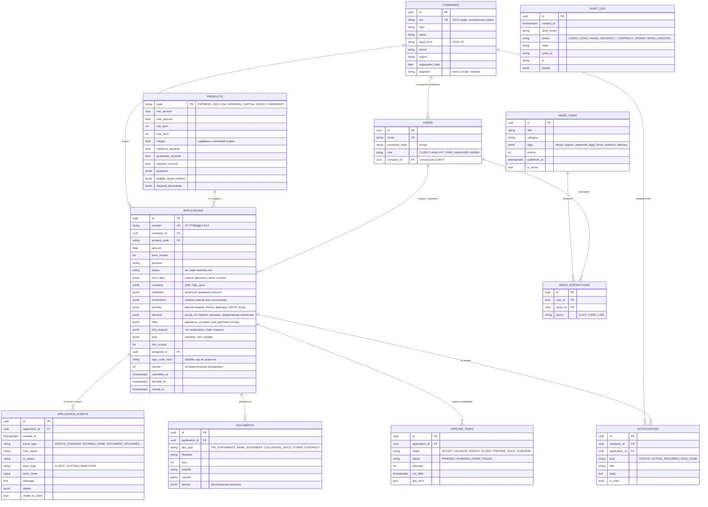

# Модель данных

СУБД — PostgreSQL 16, схема управляется миграциями Alembic ([`backend/migrations`](../backend/migrations)). Слабоструктурированные данные (анкета, ответы источников, результат скоринга, предложение) хранятся в `JSONB`: структура внешних ответов меняется чаще схемы, а снимок данных на момент решения нужен для аудита.

## Ключевые решения

* **Снимок данных на момент решения.** `enrichment` и `scoring.features` хранят ровно те данные, на которых принято решение, и версию модели (`scoring.model_version`). Решение можно воспроизвести и объяснить, даже если данные в источниках изменились.
* **Журнал событий — единый источник истории.** Таймлайн клиента — это события с `visible_to_client = true`. Внутренние события (скоринг, решения аналитика, ошибки конвейера) видят только сотрудники.
* **Очередь задач в той же БД** — transactional outbox: статус и задача фиксируются атомарно.
* **Код подписи не хранится**, только `sha256(application_id:code)`.
* **Индексы**: `applications(status)`, `applications(company_id)`, `application_events(application_id)`, `pipeline_tasks(status, run_after)`, уникальные `companies.inn`, `users.email`, `applications.number`.

## Синтетические данные

| Набор | Где | Состав |
|---|---|---|
| Профили внешних источников | [`mocks/fixtures.json`](../mocks/fixtures.json) | 10 компаний: ЕГРЮЛ, ФНС, БКИ, счета, антифрод |
| Генератор для любого ИНН | `mocks/app.py → generated_profile()` | Детерминированно по хэшу ИНН |
| Продукты, пользователи, новости, история заявок | [`backend/app/seed.py`](../backend/app/seed.py) | 5 продуктов, 7 демо-учёток, 18 материалов, 6 заявок, прогнанных через конвейер |
| Выписка по счёту | [`testdata/bank_statement_sample.csv`](../testdata/bank_statement_sample.csv) | 12 месяцев операций |
