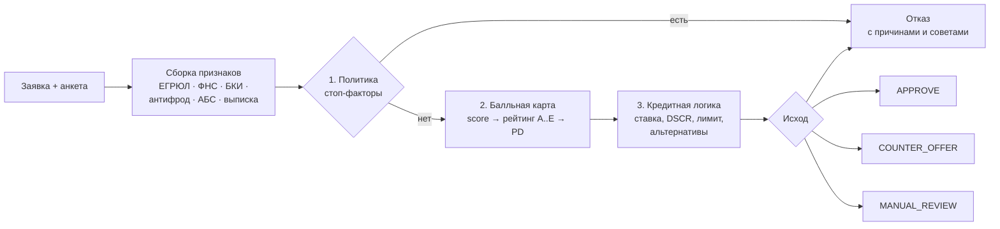

# Модель принятия кредитного решения

Реализация: [`backend/app/scoring/engine.py`](../backend/app/scoring/engine.py), версия `SME-SCORECARD-1.3`. Модель упрощена и описана явно, как допускает кейс. Структура при этом повторяет банковскую практику: **скоринг оценивает риск заёмщика, а кредитная логика определяет решение и условия**.



## 1. Источники признаков

| Признак | Источник | Приоритет |
|---|---|---|
| Срок деятельности | ЕГРЮЛ: дата регистрации | — |
| Статус компании, ОКВЭД | ЕГРЮЛ | — |
| Выручка | Выписка CSV → ФНС → обороты в АБС → анкета | Подтверждённые данные важнее заявленных |
| Расходы | Анкета; доля расходов не ниже, чем по данным ФНС | Консервативно |
| Текущие платежи по долгам | max(анкета, сумма платежей по БКИ) | Консервативно |
| Кредитная история | БКИ: балл, просрочки 12 мес., текущая просрочка, запросы 30 дней | — |
| Налоги и отметки | ФНС: недоимка, массовый адрес, недостоверность, дисквалификация | — |
| Отношения с банком | АБС: стаж счёта, поступления | — |
| Мошенничество | Антифрод: LOW / MEDIUM / HIGH | — |
| Обеспечение | Анкета: залог, поручительство собственника | — |

## 2. Политика

**Стоп-факторы** (автоматический отказ):

| Код | Условие |
|---|---|
| SF01 | Статус в ЕГРЮЛ не «действующая» (ликвидация, банкротство, не найдена) |
| SF02 | Руководитель в реестре дисквалифицированных лиц |
| SF03 | Текущая просрочка > 30 дней или просрочка > 90 дней за 12 месяцев |
| SF04 | Антифрод: высокий риск |
| SF05 | Срок деятельности < 3 месяцев |
| SF06 | Недоимка по налогам > 500 тыс. ₽ |
| SF07 | Отрицательный денежный поток |

**Триггеры ручного рассмотрения** (решение принимает специалист):

| Код | Условие |
|---|---|
| MT01 | Отметки ФНС: массовый адрес / недостоверные сведения |
| MT02 | Антифрод: средний риск |
| MT03 | Источник данных недоступен (мягкая деградация) |
| MT04 | Выручка не подтверждена внешними данными |
| MT05 | Залог требует оценки специалистом |
| MT06 | Сумма > лимита автоматического решения (10 млн ₽) |
| MT07 | Пограничный рейтинг C или D |

## 3. Балльная карта

База — **520 баллов**. Скоринг **не зависит от запрошенной суммы**: одна и та же компания получает одинаковый рейтинг, а сумма влияет на решение через DSCR. Это прямо следует из кейса: «одинаковая оценка риска может приводить к разным условиям для разных продуктов».

| Фактор | Значения → баллы |
|---|---|
| Срок деятельности | < 6 мес −60 · 6–12 −30 · 12–24 0 · 24–60 +25 · > 60 +40 |
| Рентабельность | < 0% −60 · 0–5% −15 · 5–15% +15 · > 15% +30 |
| Текущая долговая нагрузка (платежи / денежный поток) | нет долгов +20 · < 30% +10 · 30–60% −15 · > 60% −50 |
| Балл БКИ | нет истории −5 · < 500 −50 · 500–650 −10 · 650–750 +20 · > 750 +40 |
| Просрочки за 12 мес. | нет +20 · до 30 дн −20 · 31–60 −60 · 61–90 −100 |
| Запросы в БКИ за 30 дней | > 4 → −20 |
| Недоимка по налогам | есть → −40 |
| Клиент банка | ≥ 12 мес +25 · < 12 мес +10 |
| Отраслевой риск (ОКВЭД) | низкий +10 · средний 0 · повышенный −20 |
| Обеспечение | залог +20 · поручительство +10 |

**Рейтинг:** A ≥ 600 · B 550–599 · C 500–549 · D 450–499 · E < 450.
**PD** (синтетическая калибровка, 12 мес.): `PD = 1 / (1 + exp((score − 470) / 38))`, например A(695) ≈ 0,3%, A(650) ≈ 0,9%, C(520) ≈ 21%.

## 4. Кредитная логика

**Ставка** = ключевая ставка ЦБ (14%) + маржа продукта + надбавка за рейтинг (A 0 · B 1,5 · C 3 · D 5 п.п.) − 0,5 п.п. для клиентов банка.

| Продукт | Маржа | Сумма | Срок | Особенности |
|---|---|---|---|---|
| Экспресс-кредит | +6,0 | 0,3–10 млн | 3–36 | Без залога, автоматическое решение |
| Льготный кредит МСП | +2,75 | 0,5–30 млн | 6–36 | Только приоритетные ОКВЭД |
| Оборотный кредит | +5,0 | 1–50 млн | 3–24 | Поручительство собственника |
| Инвестиционный | +4,0 | 3–150 млн | 12–84 | Залог, оценка специалистом |
| Овердрафт | +7,0 | 0,1–20 млн | 1–12 | ≤ 40% поступлений по счёту |

**Лимит по денежному потоку (DSCR ≥ 1,3):**

```
денежный поток   CF = (выручка − расходы) / 12
допустимый платёж P = CF / 1.3 − текущие платежи
лимит            = min( аннуитет⁻¹(P, ставка, срок),
                        50% годовой выручки   (без залога)
                        или 70% залога + 20% выручки (с залогом),
                        40% поступлений по счёту (овердрафт),
                        максимум продукта )
```

**Выбор исхода:**

1. Стоп-фактор → **REJECT** (причины + советы по улучшению из самых негативных факторов).
2. Рейтинг E → **REJECT**.
3. Продукт недоступен (ОКВЭД, нет счёта, нет залога) → **COUNTER_OFFER** с подходящим продуктом, иначе REJECT.
4. Запрос ≤ лимита: есть триггеры → **MANUAL_REVIEW** с рекомендацией системы, иначе **APPROVE**.
5. Запрос > лимита → альтернативы (до трёх):
   * `REDUCED_AMOUNT` — максимальная сумма на запрошенный срок;
   * `LONGER_TERM` — запрошенная сумма на минимальный достаточный срок;
   * `OTHER_PRODUCT` — продукт с меньшей ставкой (например, льготный), если доступен.

   Есть альтернативы → **COUNTER_OFFER** (или MANUAL_REVIEW при триггерах), нет → REJECT.

## 5. Демо-профили и исходы

| Клиент | Рейтинг | Ключевые факторы | Запрос | Исход |
|---|---|---|---|---|
| ООО «Хлебный Дом» | A (695) | 5 лет, маржа 19%, БКИ 780, клиент банка 30 мес | Экспресс 3 млн / 24 | **APPROVE** 19,5% |
| ИП Смирнов | B (560) | 1 г 11 мес, просрочка 12 дн, платежи 60 тыс | Экспресс 5 млн / 24 | **COUNTER_OFFER**: 2,3 млн под 21,5% или льготный кредит МСП 2,35 млн под 18,25% |
| ООО «СтройМонтаж Плюс» | D (480) | Просрочка 45 дн, массовый адрес, нагрузка 54%, стройка | Оборотный 15 млн / 18 | **INFO_REQUESTED** → **MANUAL_REVIEW** |
| ООО «Ромашка Трейд» | C (500) | Дисквалификация, недоимка 1,2 млн | Экспресс 2 млн / 12 | **REJECT** (SF02, SF06) |

## 6. Объяснимость

* **Клиенту** показываются факторы с направлением влияния (🟢/🔴), допустимый платёж и советы, без внутренних баллов.
* **Аналитику** — полная балльная карта, политика, DSCR, рекомендация системы, what-if и ИИ-резюме.
* В заявке сохраняются признаки, версия модели и результат, поэтому решение можно воспроизвести.

## 7. Развитие модели

1. Накопить историю решений и дефолтов → логистическая регрессия на WoE-признаках (интерпретируемо) → Gini/KS на отложенной выборке, PSI для стабильности.
2. Транзакционные признаки по выписке и счёту: сезонность, концентрация контрагентов, кассовые разрывы.
3. Champion/challenger: новая модель считается параллельно и не влияет на решения до валидации.
