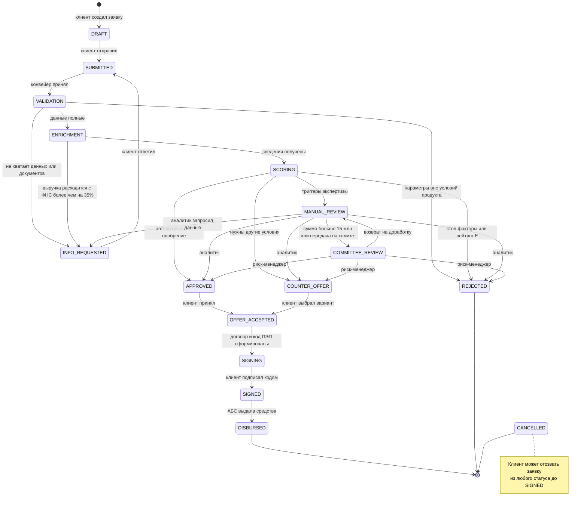

# Диаграмма состояний заявки

Источник истины — [`backend/app/state_machine.py`](../backend/app/state_machine.py). Любой недопустимый переход отклоняется с `409 Conflict`. Справочник доступен в API: `GET /api/v1/meta/statuses`.

## Статусы

| Статус | Для клиента | Этап (1–6) | Кто переводит дальше | Автоэтап конвейера |
|---|---|---|---|---|
| `DRAFT` | Черновик | 1 Заявка | Клиент | — |
| `SUBMITTED` | Отправлена | 2 Проверка | Система | `ACCEPT` |
| `VALIDATION` | Проверка данных | 2 Проверка | Система | `VALIDATE` |
| `INFO_REQUESTED` | Нужна информация | 2 Проверка | Клиент | — |
| `ENRICHMENT` | Запрос данных | 3 Оценка | Система | `ENRICH` |
| `SCORING` | Оценка | 3 Оценка | Система | `SCORE` |
| `MANUAL_REVIEW` | У специалиста | 3 Оценка | Аналитик, риск-менеджер | — |
| `COMMITTEE_REVIEW` | На согласовании | 3 Оценка | Риск-менеджер | — |
| `APPROVED` | Одобрена | 4 Решение | Клиент | — |
| `COUNTER_OFFER` | Есть предложение | 4 Решение | Клиент | — |
| `REJECTED` | Отказ | 4 Решение | — (финал) | — |
| `OFFER_ACCEPTED` | Готовим документы | 5 Договор | Система | `PREPARE_DOCS` |
| `SIGNING` | Подписание | 5 Договор | Клиент | — |
| `SIGNED` | Подписан | 5 Договор | Система | `DISBURSE` |
| `DISBURSED` | Деньги выданы | 6 Деньги | — (финал) | — |
| `CANCELLED` | Отменена | — | — (финал) | — |

## Что происходит при каждом переходе

1. Проверка допустимости по таблице `TRANSITIONS`.
2. Обновление статуса и временных меток: `submitted_at`, `decided_at`, `closed_at`.
3. Запись `ApplicationEvent`: кто, когда, откуда, куда, сообщение. Это аудит для банка и таймлайн для клиента.
4. Уведомление клиенту в кабинете (тип `ACTION_REQUIRED`, если нужен ответ клиента).
5. Постановка задачи `PipelineTask`, если у нового статуса есть автоматический этап.

Шаги 2–5 выполняются в одной транзакции БД.

## Роли и разрешённые действия

| Действие | CLIENT | ANALYST | RISK_MANAGER | ADMIN |
|---|---|---|---|---|
| Создать, заполнить, отправить, отозвать свою заявку | ✓ | | | |
| Ответить на запрос, принять предложение, подписать | ✓ | | | |
| Видеть очередь и карточки заявок | | ✓ | ✓ | ✓ |
| Решение в `MANUAL_REVIEW` | | ✓ | ✓ | ✓ |
| Решение в `COMMITTEE_REVIEW` | | | ✓ | ✓ |
| Публикация материалов ленты | | | | ✓ |
| Журнал аудита | | | ✓ | ✓ |
